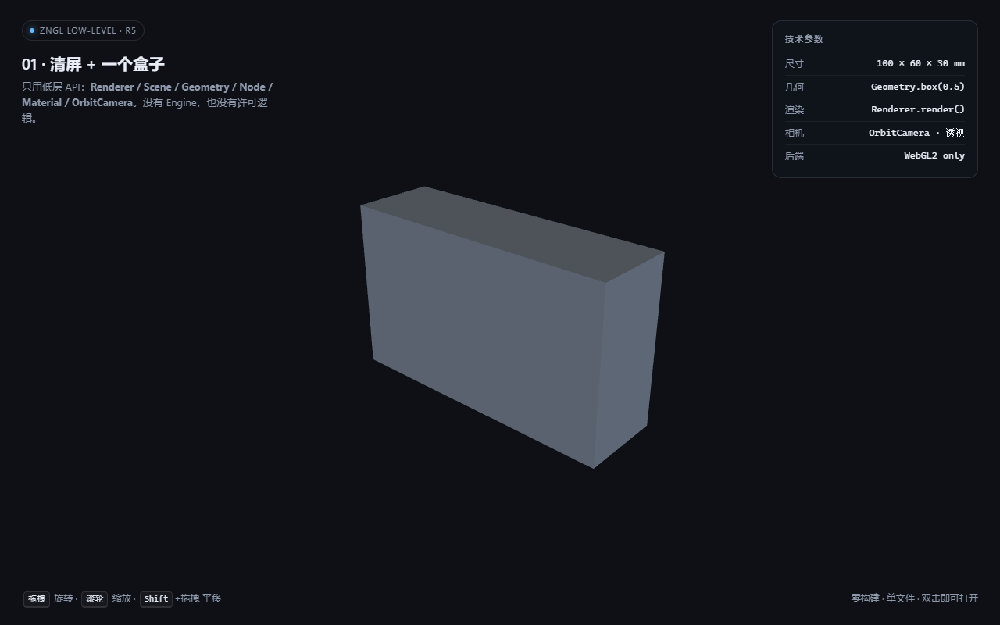
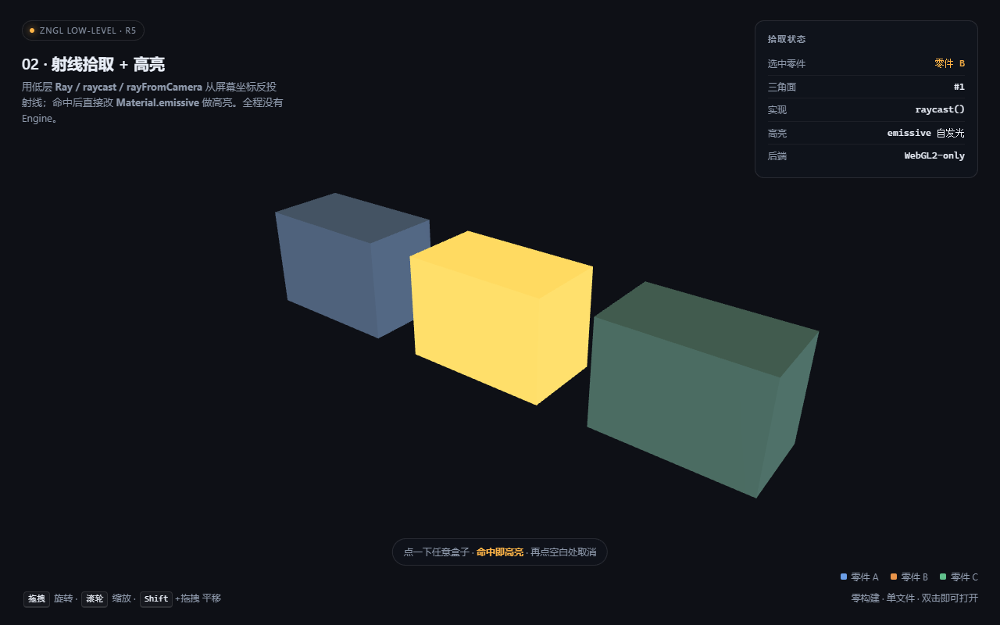
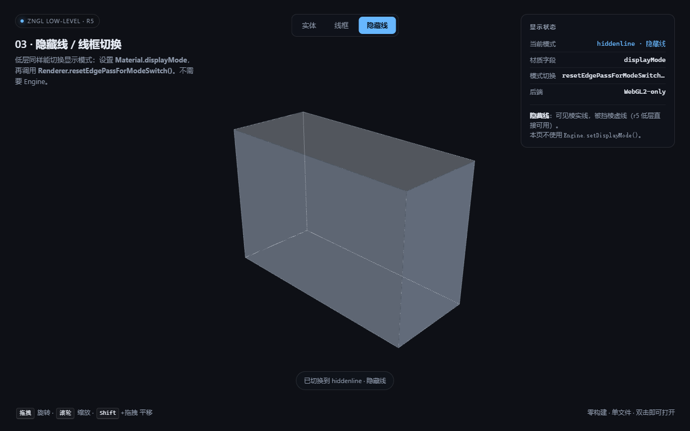

# ZNGL Viewer Sample（低层 API · 零构建）

> **License（先看这句）**：本仓库里的**示例代码**采用 MIT 许可，见
> [`LICENSE`](LICENSE)。MIT **只覆盖示例页面本身**；**不覆盖 `dist/`，也不覆盖
> ZNGL 引擎**——二者都不在本仓库中，`dist/zngl.js` 由使用者从正式发布包自行取得并按
> ZNGL 自身条款使用（见 [`LICENSE-NOTICE.md`](LICENSE-NOTICE.md)）。

三个可以直接双击打开的单文件示例（把 r5 的 `dist/zngl.js` 放进 `dist/` 后），
演示 **只用 ZNGL 低层 API** 做查看器：

- 清屏 + 一个盒子（`Renderer` / `Scene` / `Geometry`）
- 射线拾取 + 高亮（`Ray` / `raycast` / `rayFromCamera` / `Material.emissive`）
- 隐藏线 / 线框 / 实体切换（`Material.displayMode` + `Renderer.resetEdgePassForModeSwitch()`）

> **本仓库不含 Engine，也不含任何许可校验逻辑。** 没有 `new ZNGL.Engine(...)`，没有
> `__ZNGL_LICENSE__` / `__ZNGL_HOST__`，没有 Ed25519 校验、私钥或客户数据；也**不包含 `dist`**。
> 示例只使用 ZNGL 1.1.0 的 IIFE 低层构建，通过一个普通 `<script>` 引入。

---

## 1. 30 秒跑起来

1. 取得 **r5** 发布包（ZNGL 1.1.0）。
2. 把发布包的 `dist/zngl.js` 复制到本仓库的 `dist/` 目录：

   ```powershell
   # 在 r5 发布包根目录执行；把 $sample 改成你的示例仓库目录
   $sample = "C:\path\to\zngl-viewer-sample"
   New-Item -ItemType Directory -Force "$sample\dist" | Out-Null
   Copy-Item .\dist\zngl.js "$sample\dist\zngl.js"
   ```

3. 双击 `01-hello.html`、`02-pick.html` 或 `03-hiddenline.html`。

不需要 `npm install`，不需要打包器，不需要起 HTTP 服务。示例不 fetch 任何外部资源，
几何体由代码内联生成，所以 `file://` 直接打开即可。

**dist 不随本仓库分发**：本仓库的 `.gitignore` 已忽略 `dist/`。把 `dist` 单独传给别人
属于“再分发 dist”，按许可分层是禁止项；请让使用者从正式发布包自行取得。

### 替换 / 升级 dist

示例只认一个路径：`./dist/zngl.js`。替换步骤就是“覆盖这个文件”：

```powershell
$r5 = "C:\path\to\r5"
Copy-Item "$r5\dist\zngl.js" .\dist\zngl.js -Force
Get-FileHash .\dist\zngl.js -Algorithm SHA256
```

本次验证使用的文件：

| 项 | 值 |
|---|---|
| 版本 | ZNGL 1.1.0（r5） |
| 字节 | 444,069 |
| SHA256 | `84D4435141A8D0BA32E3629984A2E085B71819645CEE113CD0A5649F6FB7C504` |

如果 dist 放在别处，修改每个页面末尾的 `<script src="./dist/zngl.js"></script>` 即可；
没有构建步骤，没有模块解析。

---

## 2. 三个示例

| 页面 | 用到的低层 API | 说明 |
|---|---|---|
| [`01-hello.html`](01-hello.html) | `createWebGL2Context`、`Renderer`、`Scene`、`Geometry.box`、`uploadGeometry`、`Node`、`Material`、`Lighting`、`OrbitCamera` | 清屏 + 100×60×30 mm 盒子；自写轨道控制（拖拽/滚轮/Shift 平移） |
| [`02-pick.html`](02-pick.html) | `Ray`、`rayFromCamera`、`raycast`、`Node.worldMatrix`、`Material.emissive` | 屏幕坐标 → NDC → 世界射线；命中盒子后改自发光高亮，空白处取消 |
| [`03-hiddenline.html`](03-hiddenline.html) | `Material.displayMode`、`Material.wireframe`、`Renderer.resetEdgePassForModeSwitch` | 实体 / 线框 / 隐藏线三态切换；没有 `Engine.setDisplayMode()` |







更多截图：[`02-pick.png`](screenshots/02-pick.png)（未选中）、
[`03-shaded.png`](screenshots/03-shaded.png)、
[`03-wireframe.png`](screenshots/03-wireframe.png)。

### 关于拾取：为什么用 `rayFromCamera` 而不是 `rayFromScreen`

r5 的 `rayFromScreen` 源码里标注为“旧版从屏幕坐标构造射线（手工近似，保留兼容）”，
它的 φ 旋转符号与 `OrbitCamera.eye()` 不一致；实测中心射线会朝上偏，命中不到正中的盒子。
`rayFromCamera` 用 `inverse(proj × view)` 反投影，和 three 的 `Raycaster.setFromCamera` 同口径。
**示例统一使用 `rayFromCamera`**；这仍然是纯低层 API，不涉及 Engine。

### 关于隐藏线 / 线框（如实说明）

- **隐藏线：低层可用。** r5 的 `Renderer` 原生带棱 Pass（B1 可见棱实线、B2 被挡棱虚线）。
  页面只是设置 `material.displayMode = 'hiddenline'`，再调用公开的
  `renderer.resetEdgePassForModeSwitch()`，然后正常 `render()`。没有调用 Engine。
- **线框：低层可用，但显示的是三角形边。** 线框走 Renderer 的 line pass，`Geometry.box`
  的每个面由 2 个三角形组成，所以除了 12 条盒子棱，还会看到 6 条面对角线。这是 r5 低层
  线框路径的真实行为，不是示例画错。
- 如果业务上需要“只显示特征棱的线框”，低层没有暴露独立的特征棱线框 API；需要业务层
  自己用 `EdgeExtract.extractEdges()` 提取棱并另行绘制（隐藏线模式内部就是这么做的）。
  本示例没有为了好看去伪造这一能力。

---

## 3. 许可分层（低层免费 / Engine 收费）

> 下面是产品文案摘要，**不是正式 EULA**。正式条款以法务核定稿与商业合同为准。

**免费层：低层 API。** 不需要许可文件，也不需要注入 `__ZNGL_LICENSE__` / `__ZNGL_HOST__`。
本仓库用到的 `createWebGL2Context`、`Renderer`、`Scene`、`Geometry`、`Material`、`Lighting`、
`OrbitCamera`、`Ray`、`raycast`、`rayFromCamera` 等都属于这一层。可以用于集成、演示、
教学、评估；商用建议允许（以法务核定稿为准）。

**商业层：Engine。** `new ZNGL.Engine(canvas)` 在创建 WebGL 资源前校验许可，无有效许可
直接抛错（fail-closed）。本仓库**没有**使用 Engine，也没有实现/复制任何许可校验。

**条件与禁止项（摘要）：**

- 保留版权、商标与版本标识；
- 不改包、不打补丁绕过或禁用许可校验；
- 不剥离、删除、隐藏许可逻辑；
- 不单独再分发 `dist`、开发包、源码、许可文件或签名材料；
- 不把“低层免费”说成“Engine 免费”。

**这不是“防破解”。** JS 单文件无法防破解；这套机制是合规校验（Ed25519 签名 → 到期 →
机器绑定 → Engine fail-closed），安全边界靠合同、服务与商业条款。详见
[`LICENSE-NOTICE.md`](LICENSE-NOTICE.md)。

---

## 4. 零依赖 / 浏览器要求

- **零 npm 依赖**：没有 `package.json`、没有 node_modules、没有 CDN、没有 web font。
- **唯一运行时文件**：`dist/zngl.js`（IIFE 版，UMD 风格挂到 `window.ZNGL`），不随仓库分发。
- **WebGL2-only**：`ZNGL.createWebGL2Context()` 只创建 WebGL2；示例没有 WebGL1 或 2D 回退。
  浏览器需支持 WebGL2（Chrome / Edge / Firefox / Safari 15+ 的现代版本）。
- **零构建**：HTML 内联 CSS/JS；改完保存、刷新即可。
- **file:// 可用**：不 fetch、不加载外部模型/纹理，所有几何在页面内生成。

---

## 5. 目录结构

```
zngl-viewer-sample/
├─ 01-hello.html
├─ 02-pick.html
├─ 03-hiddenline.html
├─ README.md
├─ LICENSE-NOTICE.md
├─ .gitignore
└─ screenshots/
   ├─ 01-hello.png
   ├─ 02-pick.png
   ├─ 02-pick-selected.png
   ├─ 03-shaded.png
   ├─ 03-wireframe.png
   └─ 03-hiddenline.png

# dist/ 由使用者自行放入，已被 .gitignore 忽略
```

---

## 6. 验证记录

环境：Windows / Chrome 157 headless（SwiftShader WebGL2）/ 1280×800 / DPR 1；
dist 为 r5 的 `zngl.js`（SHA256 见 §1）。

| 页面 | 非背景像素 | `gl.getError()` | console error | 结果 |
|---|---:|---:|---:|---|
| 01-hello | 98,169 | 0 | 0 | PASS |
| 02-pick（未选中） | 122,924 | 0 | 0 | PASS |
| 02-pick（选中“零件 B”） | 122,924 | 0 | 0 | PASS |
| 03-hiddenline（实体） | 139,172 | 0 | 0 | PASS |
| 03-hiddenline（线框） | 8,257 | 0 | 0 | PASS |
| 03-hiddenline（隐藏线） | 139,895 | 0 | 0 | PASS |

附加断言：

- 三页的无内联语法错误（`node --check` 抽取后的内联脚本）；
- 02 页真实鼠标点击画布中心命中“零件 B”，`emissive = [1, 0.62, 0.08]`；
- 03 页三种模式像素哈希互不相同；隐藏线模式遥测 `visibleVerts = 24`、
  `hiddenVerts = 24`（盒子 12 条棱 × 2 端点），棱 Pass 未被禁用；
- 三页 console error 均为 0。

判定标准：非背景像素 > 1,000、console error = 0、`gl.getError() = 0`。截图见
`screenshots/`。

---

## 7. 发布到 Gitee / GitHub（只给命令，不在本任务中执行）

`.gitignore` 已经排除 `dist/`、压缩包、系统临时文件。首次建库：

```bash
git init
git add .
git commit -m "ZNGL low-level viewer samples (zero-build, WebGL2-only)"
git branch -M main

# Gitee（示例；把 YOUR_ORG 换成自己的组织/用户名）
git remote add origin git@gitee.com:YOUR_ORG/zngl-viewer-sample.git
git push -u origin main

# 或 GitHub
# git remote add origin git@github.com:YOUR_ORG/zngl-viewer-sample.git
# git push -u origin main
```

发布前检查：

```bash
git status --short                # 不应出现 dist/ 或 *.zip
git ls-files | findstr /i "zngl.js"   # 应为空（Windows）
```

**本任务只给出命令，没有实际 push、没有部署到 Gitee/GitHub。** 公开前请确认：
许可分层文案已由法务核定；`dist` 未被提交；没有把内部冻结路径、客户数据或私钥带进仓库。

---

## 8. 不含什么（边界声明）

- 不含 Engine 源码、Engine 默认装配（Gizmo / TransformControls / RenderCommand）；
- 不含许可校验逻辑、Ed25519 公钥/私钥、许可文件、签名材料；
- 不含 `dist`、开发包、源码包；
- 不含客户数据、内部路径、内部工单号；
- 不含构建脚本、npm 依赖、CDN 资源。

示例页里的“Engine”“许可”字样只出现在说明文字中，用于解释边界；代码没有调用它们。
